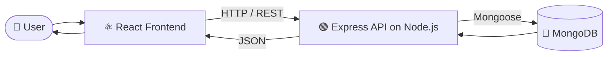

<!--
  SETUP: Replace every YOUR_USERNAME with your GitHub username.
  The repo must be named exactly YOUR_USERNAME/YOUR_USERNAME and be public.
-->

<div align="center">


<a href="https://git.io/typing-svg">
  
</a>

<br/><br/>


<br/><br/>

<a href="#-about-me">About</a> ·
<a href="#-tech-stack">Stack</a> ·
<a href="#-how-i-build">How I Build</a> ·
<a href="#-featured-projects">Projects</a> ·
<a href="#-github-analytics">Analytics</a> ·
<a href="#-lets-connect">Contact</a>

</div>

<br/>

## 👨‍💻 About Me

<table>
<tr>
<td width="58%" valign="top">

```ts
const abdulAhad = {
  role: "Full-Stack Developer",
  focus: ["React", "Node.js", "Express", "MongoDB"],
  certified: "MERN Stack Development (Creative IT, 2023)",
  education: "EEE, Green University of Bangladesh",
  mindset: "Break problems down, ship working code",
  lookingFor: [
    "Full-stack internships",
    "Junior developer roles",
    "Open-source collaboration",
  ],
} as const;
```

</td>
<td width="42%" valign="top">

**What I do**

- 🚀 Build complete web apps, from UI to API to database
- 🔌 Design clean REST APIs and connect them to responsive React front ends
- 🧩 Use my engineering background to split big problems into small, testable parts
- 🌱 Keep improving through real projects and code reviews

</td>
</tr>
</table>

---

## 🛠️ Tech Stack

<div align="center">

<table>
<tr>
<td align="center" width="25%"><b>🎨 Frontend</b></td>
<td align="center" width="25%"><b>⚙️ Backend</b></td>
<td align="center" width="25%"><b>🗄️ Database</b></td>
<td align="center" width="25%"><b>🧰 Tools</b></td>
</tr>
<tr>
<td align="center"></td>
<td align="center"></td>
<td align="center"></td>
<td align="center"></td>
</tr>
</table>

</div>

---

## 🧱 How I Build



| Layer | What I work on |
| :-- | :-- |
| 🎨 **Frontend** | Responsive UI with React and Tailwind CSS, forms, routing, state handling |
| ⚙️ **Backend** | Express servers, REST routes, middleware, error handling |
| 🗄️ **Database** | MongoDB data models, CRUD operations, queries |
| 🔧 **Workflow** | Git and GitHub, API testing with Postman, clean project structure |

---

## 🚀 Featured Projects

<div align="center">

| Project | What it does | Tech | Links |
| :-- | :-- | :-- | :-- |
| 🛒 **E-commerce Store** | Full-stack shop with products, cart and orders | MongoDB, Express, React, Node.js | [Code](https://github.com/YOUR_USERNAME/ecommerce-store) · [Live](https://YOUR_LIVE_LINK) |
| 💬 **Chat App** | Real-time messaging between users | MERN, Socket.io | [Code](https://github.com/YOUR_USERNAME/chat-app) · [Live](https://YOUR_LIVE_LINK) |
| 🌐 **Portfolio Website** | Personal site with my work and skills | React, Tailwind CSS | [Code](https://github.com/YOUR_USERNAME/portfolio) · [Live](https://YOUR_LIVE_LINK) |

</div>

<!-- Optional pinned repo cards. Fix the repo names, then remove these comment markers.
<p align="center">
  <a href="https://github.com/YOUR_USERNAME/ecommerce-store"></a>
  <a href="https://github.com/YOUR_USERNAME/chat-app"></a>
</p>
-->

---

## 📊 GitHub Analytics

<div align="center">

<picture>
  <source media="(prefers-color-scheme: dark)" srcset="https://github-readme-stats.vercel.app/api?username=YOUR_USERNAME&show_icons=true&theme=tokyonight&hide_border=true&include_all_commits=true&count_private=true" />
  <source media="(prefers-color-scheme: light)" srcset="https://github-readme-stats.vercel.app/api?username=YOUR_USERNAME&show_icons=true&theme=default&hide_border=true&include_all_commits=true&count_private=true" />
  
</picture>
<picture>
  <source media="(prefers-color-scheme: dark)" srcset="https://github-readme-stats.vercel.app/api/top-langs/?username=YOUR_USERNAME&layout=compact&theme=tokyonight&hide_border=true&langs_count=8" />
  <source media="(prefers-color-scheme: light)" srcset="https://github-readme-stats.vercel.app/api/top-langs/?username=YOUR_USERNAME&layout=compact&theme=default&hide_border=true&langs_count=8" />
  
</picture>

<br/>

<picture>
  <source media="(prefers-color-scheme: dark)" srcset="https://streak-stats.demolab.com/?user=YOUR_USERNAME&theme=tokyonight&hide_border=true" />
  <source media="(prefers-color-scheme: light)" srcset="https://streak-stats.demolab.com/?user=YOUR_USERNAME&theme=default&hide_border=true" />
  
</picture>

</div>

### 📈 Contribution Activity Graph

<div align="center">

<picture>
  <source media="(prefers-color-scheme: dark)" srcset="https://github-readme-activity-graph.vercel.app/graph?username=YOUR_USERNAME&theme=tokyo-night&hide_border=true&area=true&custom_title=Contribution%20Activity" />
  <source media="(prefers-color-scheme: light)" srcset="https://github-readme-activity-graph.vercel.app/graph?username=YOUR_USERNAME&theme=github-light&hide_border=true&area=true&custom_title=Contribution%20Activity" />
  
</picture>

</div>

### 🐍 Contribution Snake

<div align="center">

<!-- Needs snake.yml saved as .github/workflows/snake.yml and run once from the Actions tab -->
<picture>
  <source media="(prefers-color-scheme: dark)" srcset="https://raw.githubusercontent.com/YOUR_USERNAME/YOUR_USERNAME/output/github-snake-dark.svg" />
  <source media="(prefers-color-scheme: light)" srcset="https://raw.githubusercontent.com/YOUR_USERNAME/YOUR_USERNAME/output/github-snake.svg" />
  
</picture>

</div>

### 🏆 Trophies

<div align="center">

<picture>
  <source media="(prefers-color-scheme: dark)" srcset="https://github-profile-trophy.vercel.app/?username=YOUR_USERNAME&theme=onedark&no-frame=true&no-bg=true&row=1&column=7" />
  <source media="(prefers-color-scheme: light)" srcset="https://github-profile-trophy.vercel.app/?username=YOUR_USERNAME&theme=flat&no-frame=true&no-bg=true&row=1&column=7" />
  
</picture>

</div>

<details>
<summary>📉 Backup contribution chart (shows if the cards above fail to load)</summary>
<br/>
<div align="center">
  
</div>
</details>

---

## 🤝 Let's Connect

<div align="center">

<a href="https://linkedin.com/in/YOUR_LINKEDIN"></a>
<a href="https://mail.google.com/mail/?view=cm&fs=1&to=abdulahad.webdev99@gmail.com&su=Hello%20Abdul%20Ahad&body=Hi%20Abdul%2C%0A%0A"></a>
<a href="https://YOUR_PORTFOLIO_URL"></a>
<a href="https://facebook.com/YOUR_FACEBOOK"></a>

<br/><br/>


</div>

