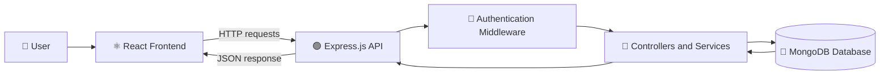

<!-- Replace every YOUR_USERNAME with your GitHub username -->

<div align="center">


<a href="https://git.io/typing-svg">
  
</a>

<br/>


<br/><br/>


</div>

---

## 👨‍💻 About Me

```js
const abdullah = {
  role: "Full Stack Developer (MERN Stack)",
  location: "Dhaka, Bangladesh 🇧🇩",
  focus: ["Full stack web applications", "REST API design", "Responsive user interfaces"],
  stack: {
    database: "MongoDB with Mongoose",
    backend: "Node.js and Express.js",
    frontend: "React with Tailwind CSS",
    auth: "JSON Web Token and bcrypt",
  },
  background: "Electrical and Electronic Engineering student at Green University of Bangladesh",
  languages: ["English", "বাংলা"],
  currentlyLearning: ["Next.js", "TypeScript", "System design", "Docker"],
  openTo: ["Freelance projects", "Open source collaboration", "Internships"],
};
```

---

## 🧱 How I Build Full Stack Apps



| Layer | What I work on |
| :--- | :--- |
| 🎨 **Frontend** | Reusable React components, hooks, context, routing, form validation, responsive design |
| ⚙️ **Backend** | RESTful APIs, middleware, error handling, input validation, file uploads |
| 🗄️ **Database** | Schema design, indexing, aggregation pipelines, relationships with Mongoose |
| 🔐 **Security** | JSON Web Token authentication, password hashing, role-based access control, Cross-Origin Resource Sharing setup |
| 🚀 **Deployment** | Vercel, Netlify, Render, environment variables, Git workflow |

---

## 🛠️ Tech Stack

<div align="center">

**The MERN Core**


**Languages**


**Frontend Ecosystem**


**Backend and Database Tools**


**Tools and Deployment**


</div>

---

## 📊 GitHub Statistics

<div align="center">


<br/>


</div>

---

## 📈 Contribution Activity

<div align="center">


</div>

---

## 🐍 Contribution Snake

<div align="center">


</div>

---

## 🚀 Featured MERN Projects

<div align="center">

<a href="https://github.com/YOUR_USERNAME/PROJECT_ONE">
  
</a>
<a href="https://github.com/YOUR_USERNAME/PROJECT_TWO">
  
</a>

<a href="https://github.com/YOUR_USERNAME/PROJECT_THREE">
  
</a>
<a href="https://github.com/YOUR_USERNAME/PROJECT_FOUR">
  
</a>

</div>

<details>
<summary><b>📌 Project ideas to showcase (click to expand)</b></summary>
<br/>

- 🛒 **E-commerce platform** with cart, payment, and an admin dashboard
- 📝 **Blog or content management system** with authentication and rich text editor
- 💬 **Real-time chat application** with Socket.IO
- ✅ **Task management app** with drag and drop boards
- 🎓 **Student portal** with role-based access control

</details>

---

## 🎯 Current Goals

- [x] Build and deploy full stack MERN applications
- [x] Master REST API design and authentication
- [ ] Learn **TypeScript** and **Next.js**
- [ ] Learn **Docker** and continuous integration pipelines
- [ ] Contribute to open source projects

---

## 🤝 Let's Connect

<div align="center">

<a href="https://github.com/YOUR_USERNAME"></a>
<a href="https://linkedin.com/in/YOUR_LINKEDIN"></a>
<a href="mailto:YOUR_EMAIL@example.com"></a>
<a href="https://facebook.com/YOUR_FACEBOOK"></a>
<a href="https://YOUR_PORTFOLIO.com"></a>

<br/><br/>


</div>

<!--
SETUP STEPS

1. Create a public repository named exactly the same as your GitHub username.
2. Add this file to it as README.md.
3. Replace every YOUR_USERNAME, PROJECT_ONE to PROJECT_FOUR, YOUR_LINKEDIN,
   YOUR_EMAIL@example.com, YOUR_FACEBOOK, and YOUR_PORTFOLIO.com value.

SNAKE ANIMATION (optional)

Create the file .github/workflows/snake.yml with this content:

name: Generate Snake Animation
on:
  schedule:
    - cron: "0 */12 * * *"
  workflow_dispatch:
permissions:
  contents: write
jobs:
  generate:
    runs-on: ubuntu-latest
    steps:
      - uses: Platane/snk/svg-only@v3
        with:
          github_user_name: ${{ github.repository_owner }}
          outputs: |
            dist/github-contribution-grid-snake-dark.svg?palette=github-dark
      - uses: crazy-max/ghaction-github-pages@v3.1.0
        with:
          target_branch: output
          build_dir: dist
        env:
          GITHUB_TOKEN: ${{ secrets.GITHUB_TOKEN }}

Then run the workflow once from the Actions tab.
-->
